<div align="center">




<a href="https://github.com/ifilllatonya?tab=followers"></a>

<a href="https://templatecraftllc.com"></a>

</div>

---

## Template Craft LLC

Mobile apps and the backends underneath them. Design, code, store submission, and everything after launch.

Most of what I ship runs on a platform I wrote, not a project I start over.

---

## ChurchApp

**One codebase. Every congregation gets their own app.**

A church sets its primary color, accent, logo, hero image and tagline in an admin dashboard. The app derives a full palette from those two hex values, caches the brand so it never launches in the wrong colors, and re-themes every screen in the product. Members see their church. Not a template with a logo dropped on it.

Congregations sign themselves up and go live without me touching a keyboard.

```
Multi-tenant NestJS API, scoped per church on every request
Brand theme derived at runtime from two hex values
White-label builds locked to one congregation, or one app serving many
Stripe Connect for giving, paid out to the church
```

[](https://apps.apple.com/us/app/id6784542879)
[](https://play.google.com/store/apps/details?id=com.templatecraft.churchapp)

---

## Shipped

<table>
<tr>
<td width="50%" valign="top">

### JCCOGTB Southern District
A full platform for a multi-congregation district. Members find events, give, watch livestreams, browse media, and message each other in real time. Leaders get role-based permissions, scheduling, announcements, and moderation.

Real-time chat · livestream · push to iOS and Android · automated email · AI assistant on the Anthropic API

[](https://apps.apple.com/us/app/jccogtb-southern-district/id6771166549)
[](https://play.google.com/store/apps/details?id=com.jccogtb.app)
[](https://app.jccogtb.com)

</td>
<td width="50%" valign="top">

### Jesus Camp Resort
Booking for a faith retreat. Guests browse accommodations, reserve a stay, pay through Stripe, and manage bookings in the app. Staff get a dashboard with reservations, analytics and guest feedback.

Stripe payments · accommodations and bookings · donations · events and gallery · AI assistant for guest questions

[](https://apps.apple.com/us/app/jesus-camp-resort/id6773993261)
[](https://play.google.com/store/apps/details?id=com.jcr.app)

</td>
</tr>
<tr>
<td width="50%" valign="top">

### COGTB Temple
The platform running for a second congregation, with its own branding, content and leadership structure.

[](https://apps.apple.com/us/app/cogtb-temple/id6782110165)
[](https://play.google.com/store/apps/details?id=com.cogtbtemple.app)

</td>
<td width="50%" valign="top">

### Ifill Gospel Studio
A home for gospel music and the people who make it. In the submission queue.

</td>
</tr>
</table>

---

## Built With

<div align="center">

[](https://skillicons.dev)


</div>

---

## Launch and after

Store submission is part of the build, not something handed back to you at the end. Everything I have submitted cleared review the first time.

After launch you get the admin dashboard. Content, images, announcements and your brand colors change from your phone, without a developer and without me. Updates and support carry on from there.

---

<div align="center">

**[templatecraftllc.com](https://templatecraftllc.com)** &nbsp;·&nbsp; **[latonya@templatecraftllc.com](mailto:latonya@templatecraftllc.com)** &nbsp;·&nbsp; **[Request me on Upwork](https://www.upwork.com/freelancers/~0139505c75f8ee32f3)** &nbsp;·&nbsp; **[LinkedIn](https://www.linkedin.com/in/latonya-i-066ab5111)**

</div>
