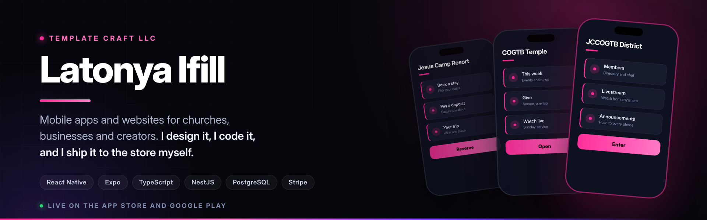

### Open for freelance and full-time work

---

## About Me

Hi, I'm Latonya — founder of **Template Craft LLC**. I design and build custom apps and websites for business owners, creatives, and ministries, and I do the work myself from first sketch to store launch.

- **Apps live in the App Store and on Google Play** — not demo links, and I handled every submission myself
- **Full-stack TypeScript** — React Native and Expo on mobile, NestJS and PostgreSQL behind it
- **Real production features** — Stripe payments, real-time chat, push notifications, and AI assistants
- **Admin tools a non-technical owner can actually run**, because most of my clients are not developers
- **Based in the USA**, working with clients anywhere

---

## Apps I've Shipped

> Live in the App Store and on Google Play. Built, submitted, and maintained by me.

<table>
<tr>
<td width="50%" valign="top">

### JCCOGTB Southern District
**A full church platform for a multi-congregation district.**

Members find events, give, watch livestreams, browse media, and message each other in real time. Leaders get role-based permissions, appointment scheduling, announcements, and moderation tools.

Real-time chat · livestream · push to iOS and Android · automated email · AI assistant on the Anthropic API

`React Native` `Expo` `TypeScript` `NestJS` `PostgreSQL` `WebSockets`

</td>
<td width="50%" valign="top">

### Jesus Camp Resort
**Booking app for a faith retreat.**

Guests browse accommodations, book a stay, pay through Stripe, and manage reservations in the app. Staff get an admin dashboard with bookings, analytics, and guest feedback in one place.

Stripe payments · accommodations and bookings · donations · events and gallery · AI assistant for guest questions

`React Native` `Expo` `TypeScript` `NestJS` `PostgreSQL` `Stripe`

</td>
</tr>
</table>

### COGTB Temple
**Church app for the Temple congregation, live in the App Store.**

The same system behind the Southern District app, rebuilt for a different congregation with its own branding, content, and leadership structure. Proof the platform ships more than once.

`React Native` `Expo` `TypeScript` `NestJS` `PostgreSQL`

### ChurchApp by Template Craft
**A ready-to-launch church app any congregation can brand as their own, live in the App Store.**

The platform as a product instead of a one-off build: a church picks its colors, logo, and content, and the app is theirs. Events, giving, announcements, media, and a member directory out of the box.

`React Native` `Expo` `TypeScript` `NestJS` `PostgreSQL`

---

## Also Built

From the same stack, finished and heading to the store:

| App | What it is | Status |
|---|---|---|
| **Ifill Gospel Studio** | A home for gospel music and the people who make it | Preparing for submission |

All React Native and Expo on the front, NestJS and PostgreSQL behind.

---

## What I Build With

---

## What I Do

Through **Template Craft LLC** I deliver done-for-you apps and websites — design, build, launch, and ongoing support.

| | |
|---|---|
| **Mobile apps** | iOS and Android, submitted and live in both stores |
| **Member portals** | Logins, roles, and permissions |
| **Booking systems** | Scheduling, reservations, and real payments |
| **Admin dashboards** | Run your business without calling a developer |
| **Backends** | APIs, databases, real-time features, push and email |
| **AI features** | Assistants, chat, automated content |

Clean, reliable, built to grow.

---

## Let's Build Yours

Tell me about your business and what you are trying to build.
I will give you a straight answer on cost and timeline.

**[templatecraftllc.com](https://templatecraftllc.com)** · **[latonya@templatecraftllc.com](mailto:latonya@templatecraftllc.com)** · **[Hire me on Upwork](https://www.upwork.com/freelancers/~0139505c75f8ee32f3)**

